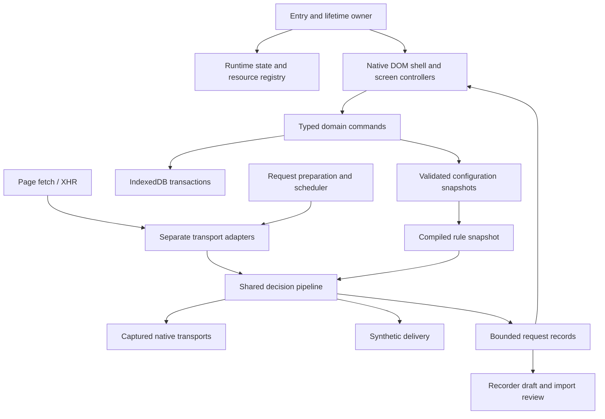

# Architecture and decisions

Status: proposed rebuild design. Browser behavior is tested under [NETWORK](NETWORK.md) and [VERIFICATION](VERIFICATION.md).

## Small composition root, explicit ownership

The entry point should capture transports, construct services, connect callbacks, mount the UI and register disposal. It should not implement profile CRUD, rule counters, imports, version parsing, scheduling or screen behavior inline.

This describes ownership, not a demand for a class or abstraction at each box. Plain functions and typed objects are enough. Use direct service calls and a small request-record subscription; do not create a generic event bus or repository/service layer for every entity.

## Proposed source boundaries

Create a file only when its slice needs it. Names can follow repository conventions; responsibilities must stay clear.

| Boundary | Owns | Must not own |
| --- | --- | --- |
| entry/lifecycle | Captured references, singleton, startup order, resource cleanup | Parsers, CRUD policies, editor fields |
| domain/model + validate | Serializable entities, validators, safe defaults, reference checks | DOM, globals, native requests |
| domain/commands | Config mutations, alias/delete impact previews, import application | Screen rendering or transport event emulation |
| state | Durable config snapshot pointer, runtime/view stores and subscriptions | Hidden network dispatch or persistence on render |
| storage | Transactions, revisions, schemas, migration, recovery | Automatically executing or activating imported data |
| network/pipeline + rules | Selection, deterministic operation plan, lifecycle records | DOM, recorder writes, per-module wrappers |
| network/fetch + xhr | Native transport semantics, operation capability, delivery | Reimplementing all XHR through fetch |
| network/body | Capture eligibility, byte/time budgets, safe transforms | Unbounded `.text()` of page streams |
| rules/mock/intercept/route/chaos | Pure validation/compilation/action semantics | Independent hook installation |
| recorder | Redacted bounded records, draft recovery, candidate promotion | Transport wrapping, saved endpoint mutation before review |
| import | Format parsers, candidates, diagnostics | Network requests, shell/JS execution, direct storage writes |
| tester | Preparation, expressions, graph, scheduler, checks, aggregation | Shared secret cache across runs |
| ui/shell + screens | Native components, focus/navigation/drafts, display commands | Matching logic or mutating saved entities per render |
| update | User-requested version/text reads and clipboard result | Code execution, passive network polling, bookmark auto-edit |

Complex-app support stays within these boundaries: request preparation owns finite native signing recipes; tester owns transient auth contexts, shared refresh coordination and bounded guard/poll steps; validators own recipe/step/reference definitions. These are explicit data contracts from [COMPLEX_APPS](COMPLEX_APPS.md), not arbitrary page-function hooks or a new plugin framework. Ordinary page requests never acquire an automatic tester refresh/retry/signing policy.

## Three state lifetimes

1. **Configuration:** validated serializable profile, endpoints, rules, plans and settings. A mutation produces a new immutable revision and schedules one durable write.
2. **Runtime:** modules active, request lifecycle, rule/sequence reservations, pauses, recorder session, run controllers, bounded results. These cannot be restored as active work after reload.
3. **View:** selected screen/endpoint, list filters/scroll, open disclosures, draft editors/imports and geometry. Keep it across internal navigation without persisting live secrets.

Observers receive record IDs and small state patches, not the whole mutable request/response. UI notifications coalesce to one frame. Update only affected regions; a traffic burst must not recreate the editor and lose caret/focus.

## Configuration and persistence flow

- Ordinary edits: validate → install a new in-memory snapshot → queue revision-ordered persistence → show Saved only after commit; failure shows a persistent Unsaved banner with export/retry. This lets editing remain usable during storage failure.
- Imports, profile replacement and restore: preview against a base revision → validate complete candidate aggregate → durable transaction → swap live pointer. On failure neither storage nor the live profile changes.
- Stale review or write: check base revision before commit, then rebuild/review changes; never silently redirect an import or overwrite a newer edit.
- Request intake captures one snapshot revision. Later editor changes cannot rewrite an in-flight request's selected actions.
- A single persistence queue serializes local writes. Atomic revision comparison detects another tab's conflicting write; show conflict/reload/export choices. Do not overwrite the newer stored revision on the next autosave.

## Decisions and rationale

| Decision | Why / verification consequence |
| --- | --- |
| Native DOM, supplied CSS, shadow root | Fits full-inline delivery and existing visual system; test host isolation and CSP separately |
| Installed TypeScript/esbuild/Playwright as development tools | No new runtime dependency; pin compatible versions in a lockfile rather than inventing a latest-version promise |
| One counted test runner | Core and browser assertions share accounting; a failed test cannot vanish into another runner's output |
| Transport-native delivery | Browser behavior is preserved where untouched; per-operation gates precede whole UI implementation |
| Operation capability instead of response-type-wide exclusion | A body edit can be unavailable while routing, headers and native binary delivery still work |
| Request ID joins records/body previews | Avoid attaching a late body to the wrong rule/URL record when concurrent identical requests complete out of order |
| IndexedDB profile aggregates initially | Atomic export/import/profile replacement is simpler than many coupled stores; split only where bounded draft/history access requires it |
| Shared components, separate screen controllers | Reuse fields/header/check/matcher/draft patterns; avoid a universal editor engine or new design framework |
| Portable schema version independent of app version | Allows backward compatibility and explicit migration gates |
| Manual data-only updates | Retains the standalone bookmark; downloaded text is copied only on request and never executed |

## Resource and cancellation ownership

Each created timer, abort listener, subscription, object URL, drag listener, body reader, run/replay child and database handle has an owner and disposer. Use one lifetime AbortController for UI listeners and explicit registries for asynchronous work that must settle. Never rely on removing the DOM to cancel network work.

Caller aborts apply to caller work. Run Stop aborts tester-owned work. Module deactivation affects subsequent requests and stops new replay children; current primary dispatch is handled under its snapshot. Close resolves pending page pauses/delays without duplicate dispatch, cancels tester/replay-owned work and leaves unrelated page requests alone. Detailed tables belong in NETWORK.

## No speculative machinery

No runtime plugin registry, dependency-injection framework, dynamically loaded parser, background worker architecture, generic workflow DSL or cloud sync. Internal adapters have only the contract their existing callers need. The full build always includes all v1 modules. Optional build recipes use compile-time entry selection, not runtime fetching.
